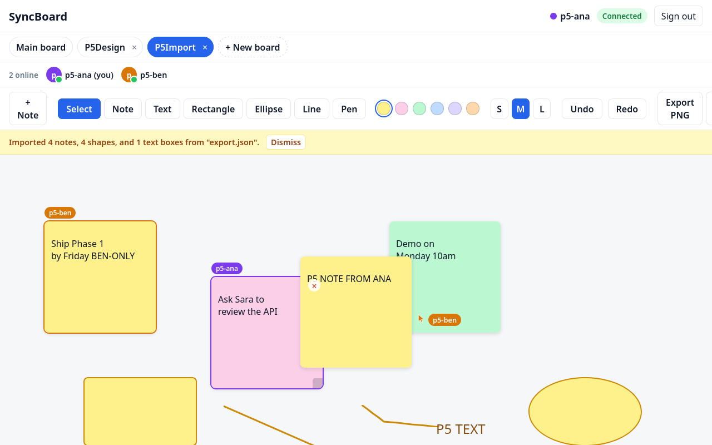
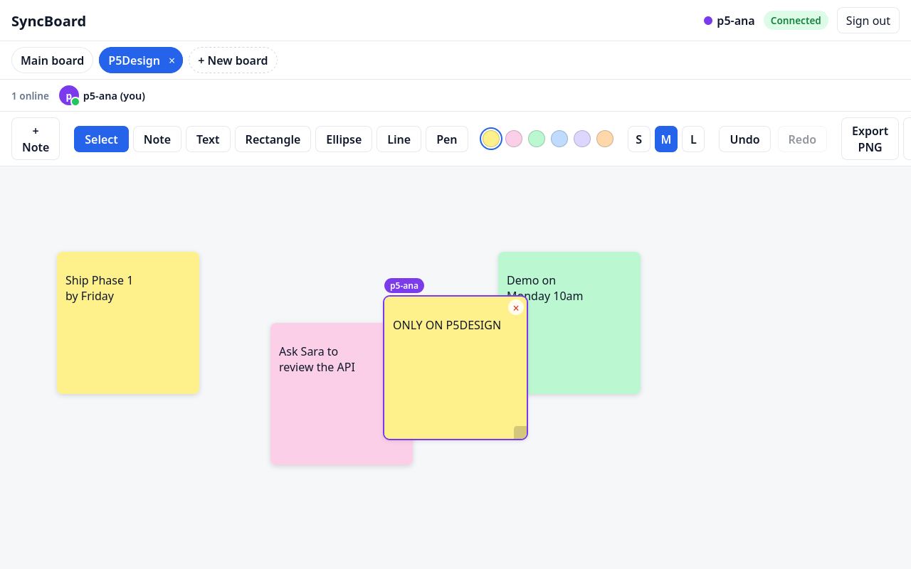
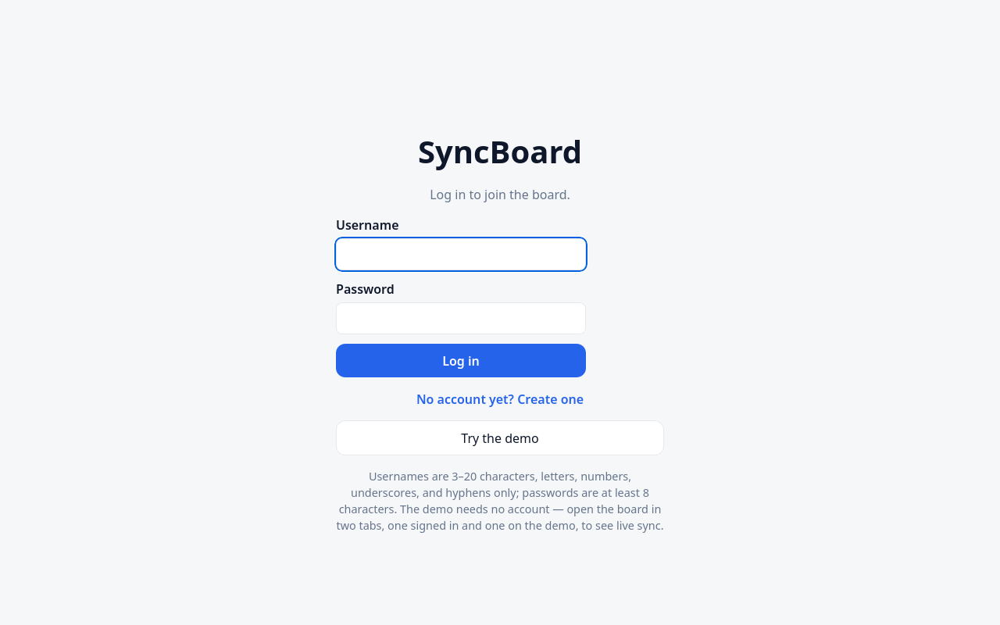

# SyncBoard

I built SyncBoard because I wanted a shared whiteboard I could actually
run myself: open a board, drop sticky notes on it, and watch other
people's cursors move around in real time — no account on someone
else's cloud, no per-seat price.

It is a real-time collaborative whiteboard in the style of Miro and
FigJam: many people editing the same board at once, live cursors,
presence, sticky notes, shapes, and text that converge without
conflicts. Every board is saved on the server, so it survives a
restart, and anyone can export a board as a PNG image or a JSON file.

## Screenshots

All three were taken from the app running locally on 2026-11-12,
with two signed-in users on the board.







## Features

- **Sticky notes:** double-click empty canvas (or the + Note button)
  to add one; type in it, drag it by its top strip, resize it with
  the corner handle, recolor it from the toolbar, delete it with the
  × button or the Delete key.
- **Shapes:** rectangle, ellipse, line, and freehand pen. Pick a tool
  and drag on empty canvas. Shapes move, resize, recolor, and delete
  like notes, and a pen stroke streams to the other tab while it is
  still being drawn.
- **Multiple boards:** the board switcher at the top lists every
  board. `POST /boards` creates one (seeded with the starter notes
  on first load, like the default board), and switching boards opens
  a fresh document, undo stack, and presence for that room — two
  people on different boards never see each other's edits.
  `DELETE /boards/:id` removes a board's document and list entry
  and leaves a tombstone, so a late save can never bring it back;
  the default board (`syncboard-demo`, "Main board") cannot be
  deleted. A client sitting on a board someone else deleted is moved
  back to the default board with a short note.
- **Text boxes:** pick the Text tool and click empty canvas. Small,
  medium, and large sizes, any toolbar color, draggable and
  resizable like notes.
- **Export and import:** Export PNG downloads a rendered image of
  the board; Export JSON downloads the board's notes, shapes, and
  text boxes as a file. Import JSON replaces the current board with
  a board from a JSON file — it asks for confirmation first, because
  replace means the current board's content is gone.
- **Real accounts:** the sign-in screen is a real login/signup form,
  not a user picker. `POST /auth/signup` creates an account
  (username 3–20 characters, letters/digits/underscore/hyphen,
  unique ignoring case; password at least 8 characters),
  `POST /auth/login` signs into one (one message for a wrong
  username and a wrong password alike), and `POST /auth/demo`
  signs in as the built-in Demo account with no password.
  Passwords are hashed with scrypt (a fresh random salt per user,
  stored as `salt:hash`) and never stored in plain text. A
  successful login or signup returns a JWT (8 hours) that the
  client stores in localStorage and sends in the Hocuspocus Auth
  message; signing out clears it, and a rejected token sends the
  user back to the sign-in screen. Each account gets a fixed
  presence color picked from its username, so the same user always
  shows the same color.
- **Presence:** the Yjs Awareness protocol shares live cursors,
  names, colors, and selections. They are ephemeral — they vanish
  when a user disconnects.
- **Undo/redo:** each user can only undo their own edits, because
  every local mutation is tagged with that user's origin.
- **Zoom and pan:** toolbar zoom controls (− / % / + / Reset,
  25–300%, centered on the visible board) and pan by dragging
  empty canvas. Both are per-user view state — they are never
  synced and never saved, so one person's zoom never moves
  another person's view, and cursors still land on the right note
  at any zoom.
- **Persistence:** the server stores the serialized Yjs document
  binary in SQLite (debounced writes, 2 seconds after the last
  change), so a board survives a server restart. The starter notes
  are seeded by the server only when a board has no saved state at
  all — deleting every note and reloading stays empty. Offline
  edits merge on reconnect: the client keeps its local document
  and Yjs syncs the difference when it comes back.

## How it works

- **One Yjs document per board.** Yjs (a CRDT) keeps every client's
  copy of the board in sync. Two people editing the same note
  converge; nobody's typing overwrites anyone else's. The document
  has three shared roots — `notes`, `shapes`, `texts` — plus a
  `board_meta` map for the board list.
- **Sync server:** Hocuspocus (Node + TypeScript) relays Yjs updates
  between clients over WebSockets and verifies a JWT in the
  handshake. The client must be `@hocuspocus/provider`, not plain
  y-websocket: Hocuspocus prefixes every message with the document
  name, so a plain y-websocket client's first message bytes get
  misread as a garbage document name.
- **Persistence:** SQLite through better-sqlite3, one file for board
  state and accounts. The schema is written so Postgres can replace
  SQLite later.
- **Auth:** scrypt password hashing, JWTs signed with a secret from
  `.env`. The server refuses to start without `JWT_SECRET`.
- **Presence:** Yjs Awareness, as above. The layout this was built
  from is in [docs/wireframes.svg](docs/wireframes.svg).

## Tech stack

- Web app: Vite 6 + React 19 + TypeScript, Yjs 13,
  `@hocuspocus/provider`
- Sync server: Node 24 + TypeScript, `@hocuspocus/server`,
  better-sqlite3, jsonwebtoken
- Shared: dependency-free types and constants in `packages/shared`
- Tests: Vitest (unit) + Playwright with Firefox (two-client
  acceptance)
- Lint: ESLint 10 flat config, typescript-eslint recommended +
  react-hooks; `npm run lint` must pass with zero warnings
- CI: GitHub Actions (`.github/workflows/ci.yml`) — install, lint,
  typecheck, test, build on every push and pull request

## Monorepo layout

```
syncboard/
  apps/web            Vite + React 19 + TypeScript — the board UI
  apps/sync-server    Hocuspocus sync server (Node + TypeScript)
  packages/shared     Dependency-free types and constants both apps use
```

## Setup

Prerequisites: Node 20 or newer (the server runs on Node 24 in CI),
npm. No other services — the database is a local SQLite file.

```bash
npm install
cp .env.example .env
npm run dev
```

- Web app: http://localhost:5173
- Sync server: ws://localhost:1234

`.env` holds four variables (all documented in `.env.example`, with
placeholder values only — never put a real secret in the example
file):

| Variable | What it is |
| --- | --- |
| `VITE_SYNC_URL` | WebSocket URL of the sync server (`ws://localhost:1234`) |
| `SYNC_PORT` | Port the sync server listens on (`1234`) |
| `JWT_SECRET` | Secret used to sign and verify JWTs — change the example value before any shared deployment; the server will not start without it |
| `DATABASE_URL` | SQLite file for board state and accounts (`file:./data/syncboard.db`) |

Other useful commands: `npm run build`, `npm run typecheck`,
`npm run test`, `npm run lint`. Run `npm run dev:web` or
`npm run dev:server` to start one side only.

To reset everything — boards back to the starter notes, accounts
gone — stop the server and delete `data/syncboard.db`.

## Testing

- `npm test` runs the Vitest unit tests (shared document helpers,
  shapes, text boxes, export/import, auth hashing, persistence).
- `npm run lint`, `npm run typecheck`, `npm run build` must all be
  green; CI runs all four on every push and pull request.
- The two-client acceptance tests are Playwright scripts (Firefox)
  in the screenshot tooling, run against the app on
  `http://localhost:5173`:
  - `verify-syncboard-expansion-acceptance.mjs` — the consolidated
    check for the expansion work: signup/login/demo, notes, all
    four shape kinds including pen, board isolation and switching,
    text boxes, PNG export content, JSON export/import round-trip,
    per-user undo, cursors and presence. 31 checks, zero console
    errors. Run it against a fresh database (delete
    `data/syncboard.db` and restart the server first), because it
    creates boards called P5Design and P5Import.
  - The per-phase scripts (`verify-syncboard-expansion-p1-shapes`,
    `-p2-boards`, `-p3-text-export`, `-p4-auth`, plus the Phase 1–5
    `verify-syncboard-phase*.mjs` scripts) are kept as they are —
    they are the record of how each phase was verified.
  - The documented acceptance results are in
    [docs/demo-test.md](docs/demo-test.md), and the step-by-step
    two-user demo is in [docs/demo-script.md](docs/demo-script.md).

## Demo

**Live demo:** https://b2a66c5b-b065-4e44-b8ee-0cc098d0fd9f-00-14lu9hdlgqec3.pike.replit.dev/

(This is a Replit dev link: it sleeps when the workspace is left idle, so if it does not load, it needs the workspace reopened. A permanent deployment would need a published Replit deployment — there is no production deployment.)

Try it with two browser windows side by side: create an account
in one and use "Try the demo" in the other, and follow
[docs/demo-script.md](docs/demo-script.md). The documented
two-user acceptance test is in
[docs/demo-test.md](docs/demo-test.md).

## Honest scope

This is dev-grade auth, not production auth: no rate limiting, no
email verification, no password reset, and the JWT secret comes
from `.env`. Do not expose the server on a shared network without
hardening it first. The demo account is shared — anyone using "Try
the demo" signs in as the same Demo user.

## Development history

The board was built in phases, each one verified before the next
started:

- **Phase 0 — Setup:** monorepo, sync server skeleton, shared data
  model, placeholder web app.
- **Phase 1 — Real-time core:** Yjs document, Hocuspocus server
  with JWT auth in the handshake, React canvas rendering notes
  from the shared map. Sign-in started as a demo-user picker
  (Ahmad, Sara, or Omar) backed by `GET /token` — that endpoint
  and the picker are gone now, replaced by real accounts (see
  "After the mission" below).
- **Phase 2 — Presence:** Awareness-driven cursors, user list,
  presence dots, selection highlighting.
- **Phase 3 — Editing UX:** double-click empty canvas (or the
  + Note button) creates a note; color picker in the toolbar sets
  the color for new notes and recolors the selected one; the
  selected note has a resize handle and a delete button, and the
  Delete key deletes it too. Per-user undo/redo: every local
  change runs under the origin `local-user-<id>`, and the
  UndoManager only tracks that origin, so your Ctrl+Z never
  reverts another user's edits. Drags and typing batch into one
  undo step.
- **Phase 4 — Persistence + reconnect:** the sync server saves
  the board to SQLite (`DATABASE_URL`, default
  `file:./data/syncboard.db` — a gitignored file, so it never
  reaches the repo). The serialized Yjs document is written back
  2 seconds after the last change, so a drag writes once instead
  of once per pointermove. A server restart restores the board,
  and the starter notes are seeded by the server only when a board
  has no saved state at all — deleting every note and reloading
  stays empty. Offline edits merge on reconnect: the client keeps
  its local document and Yjs syncs the difference when it comes
  back. To reset the board, stop the server and delete
  `data/syncboard.db`.
- **Phase 5 — Polish + demo:** toolbar zoom controls (− / % / + /
  Reset, 25–300%, centered on the visible board) and pan by
  dragging empty canvas. Both are per-user view state — they are
  never synced and never saved, so one person's zoom never moves
  another person's view, and cursors still land on the right note
  at any zoom. A step-by-step 2-user demo is in
  [docs/demo-script.md](docs/demo-script.md), and the documented
  acceptance test (two clients, same-note convergence, undo
  isolation, restart survival, fresh joiner) is in
  [docs/demo-test.md](docs/demo-test.md) — all checks passed.

**After the mission — expansion work.** Four features were added
after Phase 5, in this order: shapes (rect/ellipse/line/pen),
multiple boards, text boxes with PNG/JSON export and import, and
real accounts replacing the demo-user picker. (An earlier draft of
this README called accounts "Phase 6" — that label is dropped
here, because the mission's phases ended at Phase 5 and the
expansion work is not a numbered phase.) Phase 5 of this round
then polished the whole thing: this README rewrite, a real ESLint
setup with a clean lint, GitHub Actions CI, the consolidated
two-client acceptance script, a security pass over the tree, and
fresh screenshots.

## License

MIT — see [LICENSE](LICENSE).
